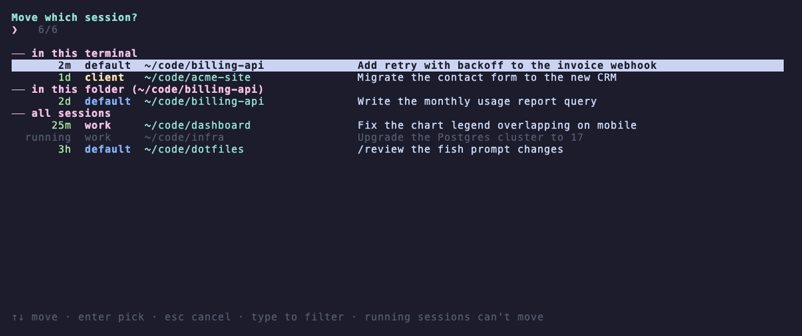
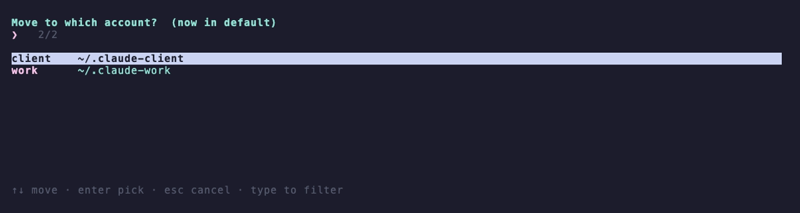
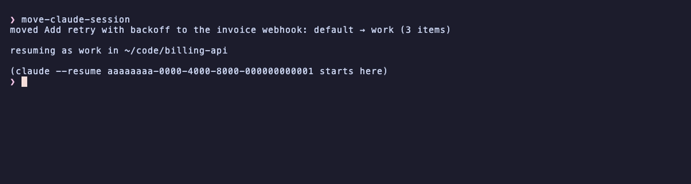

<h1 align="center">move-claude-session</h1>

<p align="center">
  Move a <a href="https://claude.com/claude-code">Claude Code</a> session to another account and pick up where you left off.
</p>

<p align="center">
  <a href="https://github.com/STRML/move-claude-session/actions/workflows/test.yml"></a>
  
  
  <a href="LICENSE"></a>
</p>

<p align="center">
  
</p>

If you run more than one Claude Code account (one per `CLAUDE_CONFIG_DIR`), each session lives in the account that started it. When that account hits its usage limit, the conversation is stuck there. `move-claude-session` moves the transcript and everything attached to it into another account, then resumes it.

```
by hand   quit ─▶ find the id ─▶ move the files ─▶ cd <project> ─▶ claude --resume <id>
with it   quit ─▶ move-claude-session ─▶ Enter ─▶ Enter
```

## Install

Python 3.9 or later. No dependencies.

```sh
git clone https://github.com/STRML/move-claude-session
ln -s "$PWD/move-claude-session/move-claude-session" ~/.local/bin/
```

Any directory on your `PATH` works in place of `~/.local/bin`.

## Use

Quit the session, then run this in the same terminal:

```sh
move-claude-session
```

1. Pick the session. The one you just quit is on top and already selected.
2. Pick the account to move it to. The one you moved to last time is preselected, and with only one other account this step is skipped.

It moves the session, `cd`s into the session's project directory, and resumes it under the new account.

<p align="center"><br><sub>1 · pick the session</sub></p>

<p align="center"><br><sub>2 · pick the account</sub></p>

<p align="center"><br><sub>3 · it moves and resumes</sub></p>

| Key | Action |
|---|---|
| <kbd>↑</kbd> <kbd>↓</kbd> | Move the selection |
| Type anything | Filter. Space-separated words must all match. |
| <kbd>Enter</kbd> | Pick |
| <kbd>Esc</kbd> | Cancel. Nothing changes. |

Rows marked `running` belong to a live Claude Code process and can't be picked until it exits.

### Sessions are grouped by where you are

```
── in this terminal     ran in this terminal pane                (up to 10)
── in this folder       its project is the current directory     (up to 20)
── all sessions         newest first, across every account       (up to 40)
```

Each session shows up once, in the first group it fits, newest first. "In this terminal" comes from [cmux](https://cmux.dev), which records the pane each Claude Code session runs in. Without cmux that group is left out, and the session you just quit tops "in this folder" instead.

The title on each row is the one Claude Code puts on the terminal tab: your `/rename` title, else the title Claude Code generated, else your first prompt.

### Without the picker

```sh
move-claude-session <session-id> <account>
```

This moves the session and prints the command to resume it. Add `-n` to see every file that would move.

| Option | Effect |
|---|---|
| `-n`, `--dry-run` | Show what would move. Change nothing. |
| `--force` | Overwrite files already at the destination, and move a session that is still running. |
| `--list` | Print the picker's rows, with session IDs and groups, and exit. |

## Accounts

An account is any config dir in your home directory with a `projects/` folder in it. Nothing to configure.

| Account | Config dir | `claude` runs with |
|---|---|---|
| `default` | `~/.claude` | `CLAUDE_CONFIG_DIR` unset |
| `<name>` | `~/.claude-<name>` | `CLAUDE_CONFIG_DIR=~/.claude-<name>` |

To add one, run `CLAUDE_CONFIG_DIR=~/.claude-work claude` once and log in.

## How it works

<details>
<summary><b>What moves</b></summary>

<br>

Paths are relative to the account's config dir:

```
projects/<project>/<session-id>.jsonl     the transcript
projects/<project>/<session-id>/          subagent transcripts, saved tool output
projects/<project>/cship/<session-id>-*   cship caches
<any other dir>/*<session-id>*            file-history, tasks, session-env, ...
```

The session keeps its project folder name in the new account, so `claude --resume` finds it from the same working directory. Every old path inside the moved transcripts is rewritten to its new location, so saved tool output still resolves.

</details>

<details>
<summary><b>How it knows a session is still running</b></summary>

<br>

Claude Code registers each live session in `<config dir>/sessions/<pid>.json` and deletes that file on exit. A session counts as running while that file exists and its process is alive. You can move a session the moment you quit it.

</details>

<details>
<summary><b>Title cache</b></summary>

<br>

Titles are cached in `~/.cache/move-claude-session/labels.json` (`$XDG_CACHE_HOME` is respected). Each entry is keyed on its transcript's size and mtime, so a session you just quit always shows its current title. On a machine with about 6,200 transcripts, a run takes about 0.3 s without the cache and under 0.1 s with it.

</details>

## Tests

```sh
python3 -m unittest discover tests
```

The tests build a fake home directory with three accounts and made-up sessions (`tests/fixture.py`), drive the picker through a real pseudo-terminal, and check what moved and how `claude` was launched. The screenshots come from the same fixture: `vhs demo/demo.tape` re-renders them.

## License

[MIT](LICENSE)
