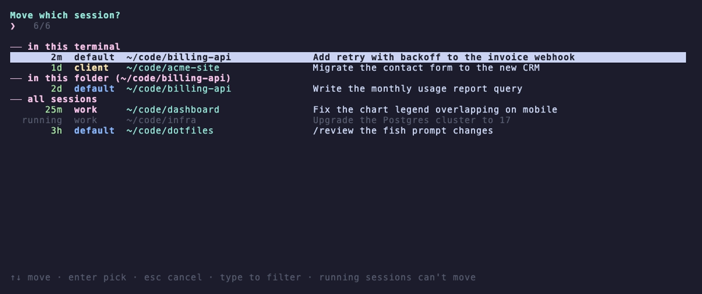
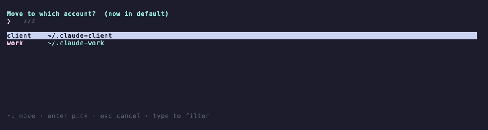
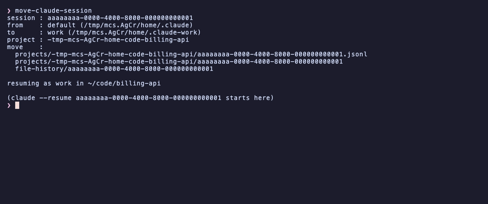

<h1 align="center">move-claude-session</h1>

<p align="center">
  Move a <a href="https://claude.com/claude-code">Claude Code</a> session to another account and pick up where you left off.
</p>

<p align="center">
  <a href="https://github.com/STRML/move-claude-session/actions/workflows/test.yml"></a>
  
  
  <a href="LICENSE"></a>
</p>

<p align="center">
  
</p>

If you run more than one Claude Code account (one per `CLAUDE_CONFIG_DIR`), each session lives in the account that started it. When that account hits its usage limit, the conversation is stuck there. `move-claude-session` moves the transcript and everything attached to it into another account, then resumes it.

```
by hand   quit ─▶ find the id ─▶ move the files ─▶ cd <project> ─▶ claude --resume <id>
with it   quit ─▶ move-claude-session ─▶ Enter ─▶ Enter
```

## Install

Python 3.9 or later. No dependencies.

```sh
git clone https://github.com/STRML/move-claude-session
ln -s "$PWD/move-claude-session/move-claude-session" ~/.local/bin/
```

Any directory on your `PATH` works in place of `~/.local/bin`.

## Use

Quit the session, then run this in the same terminal:

```sh
move-claude-session
```

1. Pick the session. The one you just quit is on top and already selected.
2. Pick the account to move it to. The one you moved to last time is preselected, and with only one other account this step is skipped.

If you list other machines (see [Other machines](#other-machines)), a machine step comes between the two.

It moves the session, `cd`s into the session's project directory, and resumes it under the new account.

<p align="center"><br><sub>1 · pick the session</sub></p>

<p align="center"><br><sub>2 · pick the account</sub></p>

<p align="center"><br><sub>3 · it moves and resumes</sub></p>

| Key | Action |
|---|---|
| <kbd>↑</kbd> <kbd>↓</kbd> | Move the selection |
| Type anything | Filter. Space-separated words must all match. |
| <kbd>Enter</kbd> | Pick |
| <kbd>Esc</kbd> | Cancel. Nothing changes. |

Rows marked `running` belong to a live Claude Code process and can't be picked until it exits.

### Sessions are grouped by where you are

```
── in this terminal     ran in this terminal pane                (up to 10)
── in this folder       its project is the current directory     (up to 20)
── all sessions         newest first, across every account       (up to 40)
```

Each session shows up once, in the first group it fits, newest first. "In this terminal" comes from [cmux](https://cmux.dev), which records the pane each Claude Code session runs in. Without cmux that group is left out, and the session you just quit tops "in this folder" instead.

The title on each row is the one Claude Code puts on the terminal tab: your `/rename` title, else the title Claude Code generated, else your first prompt.

### Without the picker

```sh
move-claude-session <session-id> <account>
```

This moves the session and prints the command to resume it. Add `-n` to see every file that would move. To move it to another machine, name the account there and the ssh host:

```sh
move-claude-session <session-id> sigint@studio2
```

| Option | Effect |
|---|---|
| `-n`, `--dry-run` | Show what would move. Change nothing. |
| `--force` | Overwrite files already at the destination, and move a session that is still running. |
| `--list` | Print the picker's rows, with session IDs and groups, and exit. |

## Accounts

An account is any config dir in your home directory with a `projects/` folder in it. Nothing to configure.

| Account | Config dir | `claude` runs with |
|---|---|---|
| `default` | `~/.claude` | `CLAUDE_CONFIG_DIR` unset |
| `<name>` | `~/.claude-<name>` | `CLAUDE_CONFIG_DIR=~/.claude-<name>` |

### Add an account

A moved session resumes with the new account's settings, skills, hooks and `CLAUDE.md`. If those differ from the old account's, the conversation continues with different tools and rules than it started with. To avoid that, symlink the shared config from `~/.claude` and keep only the login and the sessions separate:

```
~/.claude/                 default account, a real directory holding the shared config
~/.claude-work/
├── settings.json  ─▶ ~/.claude/settings.json
├── CLAUDE.md      ─▶ ~/.claude/CLAUDE.md
├── skills/ agents/ commands/ hooks/ plugins/ rules/  ─▶ ~/.claude/…
└── credentials, projects/, history                   stay per account
```

1. Make the config dir: `mkdir ~/.claude-work`.
2. Link the shared config into it:

   ```sh
   for f in settings.json CLAUDE.md skills agents commands hooks plugins rules; do
     [ -e ~/.claude/$f ] && ln -s ~/.claude/$f ~/.claude-work/$f
   done
   ```

   If `settings.json` points at a status line script inside `~/.claude`, link that script too.
3. Add a launcher at `~/.local/bin/claude-work` and make it executable:

   ```sh
   #!/bin/bash
   exec env CLAUDE_CONFIG_DIR="$HOME/.claude-work" claude "$@"
   ```

   Unlike a shell alias, a script runs from any shell, a cron job or a headless `claude-work -p`.
4. Run `claude-work` and log in with `/login`. Your first session there creates `projects/`, which is how this tool finds the account.

Keep `~/.claude` a real directory. An account switcher that replaces it with a symlink to `~/.claude-<name>` makes this tool list that account twice, once as `default`.

<details>
<summary><b>Have Claude Code set it up</b></summary>

<br>

Paste this into a Claude Code session:

```text
Set up a second Claude Code account on this machine that shares my config.
Ask me for the account name, then use it as NAME below.

1. Leave ~/.claude as it is. It must stay a real directory.
2. Create ~/.claude-NAME.
3. In ~/.claude-NAME, symlink each of these from ~/.claude that exists:
   settings.json, CLAUDE.md, skills, agents, commands, hooks, plugins,
   rules, and any status line script that settings.json references inside
   ~/.claude. Do not link credentials, projects/, history or session state.
4. Write an executable script at ~/.local/bin/claude-NAME:
       #!/bin/bash
       exec env CLAUDE_CONFIG_DIR="$HOME/.claude-NAME" claude "$@"
   Check that ~/.local/bin is on my PATH.
5. Tell me to run claude-NAME and log in with /login.
6. After I log in, check that /status in claude-NAME shows the new account,
   that plain claude still shows the old one, and that a skill in
   ~/.claude/skills is listed in both.
```

</details>

## Other machines

To move sessions to another machine, list its ssh alias in `~/.config/move-claude-session/hosts`, one per line (`$XDG_CONFIG_HOME` is respected):

```
studio1
studio2
```

`MOVE_CLAUDE_SESSION_HOSTS="studio1 studio2"` replaces the file. With no hosts listed there is no machine step, and the tool works exactly as before.

The picker then asks for the machine after the session. The machine you used last time is preselected:

```
Move to which machine?
❯   3/3

  local     this machine
  studio1   over ssh
  studio2   over ssh
```

The account step lists every `~/.claude` and `~/.claude-<name>` on that machine, read over ssh. An account you've logged in to but never run a session in has no `projects/` yet. It's still listed, and picking it creates `projects/`:

```
Move to which account on studio2?  (now in sigint on this machine)
❯   3/3

  default   ~/.claude
  rush      ~/.claude-rush  no sessions yet
  sigint    ~/.claude-sigint
```

The other machine needs:

- an ssh login that works without a prompt (the tool runs ssh with `BatchMode=yes`, so a password or passphrase prompt fails instead of hanging);
- `sh`, `tar`, and `shasum` or `sha256sum`, which every Mac and most Linux machines have;
- the session's project at the same absolute path.

The tool moves the session, not the code. Check the repo out on the other machine first. If the session's directory isn't there, the tool says so and prints the resume command instead of resuming in the wrong place.

After the move, it resumes the session on the other machine:

| Where you run it | What opens |
|---|---|
| In [cmux](https://cmux.dev) | a `cmux ssh` workspace running `cd <dir> && claude --resume <id>` |
| Anywhere else | the same command in this terminal, through `ssh -t` and a login shell |

For an account other than `default`, the command sets `CLAUDE_CONFIG_DIR`, the same thing the launcher in [Add an account](#add-an-account) does.

`cmux session move` (cmux 0.65 and later) also moves a session to another machine, and carries the git checkout with it. It has no option to pick the account, so it can't move a session from one account to another the way this tool does.

## How it works

<details>
<summary><b>What moves</b></summary>

<br>

Paths are relative to the account's config dir:

```
projects/<project>/<session-id>.jsonl     the transcript
projects/<project>/<session-id>/          subagent transcripts, saved tool output
projects/<project>/cship/<session-id>-*   cship caches
<any other dir>/*<session-id>*            file-history, tasks, session-env, ...
```

The session keeps its project folder name in the new account, so `claude --resume` finds it from the same working directory. Every old path inside the moved transcripts is rewritten to its new location, so saved tool output still resolves.

The move copies everything first, rewrites the copies, and deletes the originals only after that succeeds. If a copy fails, the copies are removed and the session is left untouched where it was.

</details>

<details>
<summary><b>How a move to another machine stays safe</b></summary>

<br>

```
here                                   studio2
1  list accounts              ──ssh─▶  ~/.claude, ~/.claude-*
2  check the destination      ──ssh─▶  anything already there? project dir there?
3  send a tar of the session  ──ssh─▶  ~/.claude-sigint/.move-claude-session-<id>.partial/
4  send each file's SHA-256   ──ssh─▶  check each file, then move them into place
5  delete the originals here  ◀─────── only after step 4 reports done
```

Transcripts are rewritten before they're sent, so paths inside them point at the new account on the other machine. If a step fails, the staging folder is removed and nothing here changes. If the connection drops during step 4, the tool can't tell whether the move landed, so it deletes nothing here and says so. Run the same move again: if the first one landed, it stops with "destination already exists".

</details>

<details>
<summary><b>How it knows a session is still running</b></summary>

<br>

The tool runs `claude agents --json` for every account at once. A session it lists with a live process is running. You can move a session the moment you quit it. If that command fails (say, `claude` isn't on your `PATH`), the tool stops rather than guess. Quit the session and pass `--force` to skip the check.

</details>

<details>
<summary><b>Title cache</b></summary>

<br>

Titles are cached in `~/.cache/move-claude-session/labels.json` (`$XDG_CACHE_HOME` is respected). Each entry is keyed on its transcript's size and mtime, so a session you just quit always shows its current title. On a machine with about 6,200 transcripts, a run takes about 0.3 s without the cache and under 0.1 s with it.

</details>

## What it relies on

Most of this is documented Claude Code behavior. Titles are the exception: Claude Code calls the transcript format internal and says it changes between versions, so a release can blank the titles. When that happens the tool falls back to your first prompt, and then to the session ID. Moves keep working.

| Need | Source | Documented |
|---|---|---|
| Where an account keeps sessions | `CLAUDE_CONFIG_DIR` | ✓ [env vars](https://code.claude.com/docs/en/env-vars) |
| Where a session's transcript is | `projects/<project>/<session-id>.jsonl`, long names truncated and hashed | ✓ [sessions](https://code.claude.com/docs/en/sessions#where-transcripts-are-stored) |
| Which sessions are running | `claude agents --json` | ✓ [agent view](https://code.claude.com/docs/en/agent-view) |
| Resuming | `claude --resume <session-id>` | ✓ [sessions](https://code.claude.com/docs/en/sessions#resume-a-session) |
| Session titles | `ai-title` and `custom-title` records in the transcript | ✗ internal format |
| Which terminal a session ran in | cmux's `~/.cmuxterm/claude-hook-sessions.json` | ✗ cmux internal, optional |
| Files besides the transcript | `file-history/`, `tasks/`, and other per-session entries | ✗ moved as found |

## Tests

```sh
python3 -m unittest discover tests
```

The tests build a fake home directory with three accounts and made-up sessions (`tests/fixture.py`), drive the picker through a real pseudo-terminal, and check what moved and how `claude` was launched. The screenshots come from the same fixture: `vhs demo/demo.tape` re-renders them.

The running check depends on `claude agents --json`, which CI can't reach. After a Claude Code update, check it against the real `claude` (it resumes one of your sessions and quits it, without sending a prompt):

```sh
cd <the session's project directory>
python3 tools/live-quit-check.py <session-id>
```

## License

[MIT](LICENSE)
